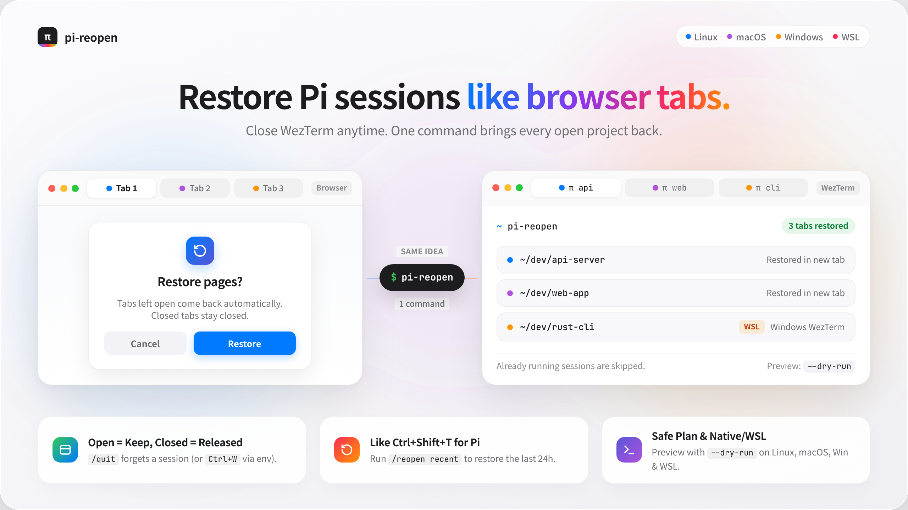

# pi-reopen — restaura sesiones de Pi en WezTerm

[English](README.md) · [简体中文](README.zh-CN.md) · [日本語](README.ja-JP.md) · [한국어](README.ko-KR.md) · [Deutsch](README.de-DE.md) · [Français](README.fr-FR.md) · [Español](README.es-ES.md) · [Português (BR)](README.pt-BR.md) · [Русский](README.ru-RU.md) · [Paquete de Pi](https://pi.dev/packages/@ellieyujin/pi-reopen) · [Versiones](https://github.com/AuthurX/pi-reopen/releases)

**Reabre WezTerm. Restaura tus sesiones del agente de código Pi, sus directorios de trabajo y sus conversaciones con un solo comando.**



Una extensión y CLI de [Pi](https://github.com/earendil-works/pi) para la **recuperación de sesiones tras cerrar el terminal**. Registra las sesiones de Pi abiertas y las reabre como pestañas de [WezTerm](https://wezterm.org/), omitiendo las que ya están en ejecución.

## ¿Retomar una sesión o restaurar un espacio de trabajo?

| Objetivo | Usar |
| --- | --- |
| Continuar la sesión más reciente del directorio actual | `pi -c` integrado |
| Elegir una conversación histórica | `pi -r` o `/resume` integrados |
| Reabrir las sesiones de Pi registradas entre proyectos tras cerrar WezTerm | `pi-reopen` |
| Previsualizar el plan de recuperación sin abrir pestañas | `pi-reopen restore --dry-run` |

Es una **restauración de sesiones del espacio de trabajo**, no un reemplazo del selector de sesiones de Pi. Inicia nuevos procesos de Pi con los archivos de sesión originales; no restaura herramientas en ejecución, estado sin guardar, geometría de paneles divididos ni programas de shell arbitrarios. Salir de Pi de forma deliberada elimina su registro. El arranque de WezTerm no dispara la recuperación automáticamente; ejecuta `pi-reopen` tras reabrirlo.

## Cómo usarlo: piénsalo como pestañas del navegador

| Navegador | pi-reopen |
| --- | --- |
| Pestañas aún abiertas al salir | Sesiones de Pi aún abiertas al cerrar WezTerm |
| Las pestañas abiertas vuelven en el próximo arranque | `pi-reopen` restaura los registros conservados como nuevas pestañas |
| Las pestañas que cerraste tú no entran en la lista de restauración | Una pestaña cerrada con `ctrl+w` se olvida por defecto (o siempre, si haces `/quit` dentro de Pi) |
| «Recientemente cerradas» con Ctrl+Shift+T | `/reopen recent` — las últimas 24 h, incluso sin registro |
| Caída → «¿Restaurar páginas?» | Caída / cerrar WezTerm entero / apagado de WSL → se conservan todos los registros, `pi-reopen` los recupera |

La regla a recordar: **abierto = se conserva, cerrado = se libera**. Sin marcadores ni comandos extra — dejar una pestaña abierta es tu señal de «quiero esto de vuelta», y cerrarla dice «ya terminé con ella». (Por defecto: cerrar una pestaña la saca de la lista de restauración, como un navegador; fija `PI_REOPEN_FORGET_ON_TAB_CLOSE=0` para conservar siempre los registros.)

## Caso de uso y soporte de plataformas

**Diseñado para trabajar entre proyectos en WezTerm: tienes varias sesiones de Pi abiertas, cierras el terminal y quieres recuperar las sesiones registradas con sus directorios de trabajo y conversaciones.** Reabre WezTerm y ejecuta `pi-reopen` para restaurar las sesiones pendientes en nuevas pestañas.

| Entorno de ejecución | Estado de soporte | Dónde se reabren las sesiones |
| --- | --- | --- |
| Linux nativo | Implementado | Nuevas pestañas en la instancia local de WezTerm en Linux |
| macOS nativo | Implementado | Nuevas pestañas en la instancia local de WezTerm en Mac |
| Windows nativo | Implementado | Nuevas pestañas en la instancia local de WezTerm en Windows, ejecutando Pi nativo de Windows |
| WSL | Implementado | Nuevas pestañas en WezTerm de Windows, lanzando Pi en la distribución WSL correspondiente |
| FreeBSD y otros sistemas | No soportado | La comprobación previa de restauración rechaza plataformas no soportadas |

**El único objetivo de restauración es el WezTerm local.** No se soporta la restauración en Windows Terminal, iTerm2, el terminal integrado de VS Code ni tmux. PowerShell, Bash y zsh son shells, no aplicaciones terminal objetivo; ejecutar el comando desde PowerShell sigue requiriendo WezTerm abierto. Windows nativo y WSL son entornos separados: una instalación en un lado no puede restaurar sesiones del otro. No se soporta migración entre máquinas.

«Implementado» significa que existe una ruta de restauración específica de la plataforma, no que todos los escenarios en máquina real hayan sido verificados. Ver [notas de plataforma](docs/PLATFORMS.md) para cobertura de validación y limitaciones.

## Inicio rápido

`@ellieyujin/pi-reopen` es el único paquete npm mantenido. El comando CLI sigue siendo `pi-reopen`.

```bash
pi install npm:@ellieyujin/pi-reopen@latest
npm install -g @ellieyujin/pi-reopen@latest --omit=peer
pi-reopen setup
```

`setup` agrupa las comprobaciones del origen de la extensión, si su proceso registrado sigue vivo, la CLI global y el PATH, la alineación de versiones y las entradas legacy duplicadas. Muestra los próximos comandos según la plataforma, pero nunca ejecuta `sudo`, `setx` ni cambia la configuración del sistema.

Ejecuta `/reload` en cada Pi existente para que empiece a registrar. Tras cerrar y reabrir WezTerm:

```bash
pi-reopen restore --dry-run
pi-reopen
```

Ver [instalación y migración](#instalación) antes de cambiar el nombre del paquete.

## Requisitos

- **Linux / macOS / Windows nativo + WezTerm local**, o **WSL + WezTerm de Windows**
- Node ≥ 22.19, con [Pi](https://github.com/earendil-works/pi) instalado en el mismo entorno de SO
- Abre WezTerm antes de restaurar; esta herramienta añade pestañas a una instancia en ejecución, no a un dominio SSH remoto
- Linux/macOS/WSL requieren Bash. Windows nativo requiere Windows PowerShell 5.1 (incluido CIM); instala Git for Windows para la herramienta Bash de Pi, y prefiere un nightly reciente de WezTerm
- La restauración WSL usa el usuario por defecto de la distribución; ejecuta esta herramienta como ese usuario. No compartas un único registro entre Windows nativo y WSL

La versión 1.0.0 es el primer lanzamiento estable. CI ejecuta pruebas de plataforma en Linux, macOS y Windows, con la suite de regresión completa, las comprobaciones del tarball empaquetado y el ciclo de vida real de PTY de Pi en Linux; la aceptación de cierre/reapertura del GUI de macOS/Windows aún necesita verificación en máquina real. Ver [notas de plataforma](docs/PLATFORMS.md).

## Uso

```bash
pi-reopen
```

```text
  ✔ pi-workspace: iniciado y confirmado (/home/ellie/work/MY/code/pi-workspace)
  ⚠ other-proj: pestaña creada, arranque de pi no confirmado a tiempo (/home/ellie/work/other-proj)
Procesados 2
```

La salida sigue la locale: chino para `zh_*`, inglés en otro caso. Fúrzalo con `PI_REOPEN_LANG=zh|en`.

| Salida | Significado |
| --- | --- |
| `✔ iniciado y confirmado` | iniciado y confirmado |
| `⚠ pestaña creada, arranque de pi no confirmado a tiempo` | pestaña creada, pero la confirmación del arranque de pi expiró |
| `Procesados N` | N procesados |

Puntos de entrada equivalentes dentro de Pi:

- `/reopen` — restaurar los Pis registrados
- `/reopen recent` — recuperar del historial de conversaciones de las últimas 24 h (para ventanas no registradas)
- `/reopen clear` — vaciar el registro (no borra los archivos de conversación)
- `Ctrl+Mayús+O` — restauración con un clic

`/all` sigue funcionando como alias obsoleto de `/reopen` (muestra un aviso de cambio de nombre).

## Comandos

| Comando | Descripción |
| --- | --- |
| `pi-reopen` (es decir `pi-reopen restore`) | Reabre los Pis que seguían abiertos en el último cierre; los en ejecución se omiten |
| `pi-reopen restore --dry-run` | Muestra solo el plan, no abre pestañas |
| `pi-reopen restore --no-wait` | Omite la espera de la confirmación de arranque de cada pi |
| `pi-reopen restore --only <patrón>` | Restaura solo las sesiones coincidentes (subcadena, glob `*` o índice de la lista actual; nombre, ruta o id) |
| `pi-reopen restore --interactive` | Muestra la lista actual e introduce índices para seleccionar sesiones |
| `pi-reopen restore --limit <N>` | Abre como máximo N pestañas en esta ejecución; el resto se difiere para la próxima |
| `pi-reopen restore --json` | Salida legible por máquina |
| `pi-reopen list [--wide\|--json]` | Lista miembros registrados y estado; el contenido largo se trunca al ancho del terminal por defecto |
| `pi-reopen show <índice\|id\|prefijo> ...` | Muestra estado, rutas, archivo de sesión y detalles de registro |
| `pi-reopen forget <índice\|id\|prefijo> ...` | Descarta registros concretos (los archivos de conversación no se tocan) |
| `pi-reopen prune [--dry-run]` | Descarta registros caducados/sin recuperación (conserva los últimos 14 días) |
| `pi-reopen setup` | Comprobaciones guiadas de primera ejecución; muestra comandos sin cambiar el sistema |
| `pi-reopen doctor` | Comprobación de entorno y registro (identidad del proceso de extensión, coincidencia de versión y detección de cierre de pestaña única en WSL) |
| `pi-reopen clear` | Vacía el registro y las reclamaciones de arranque (no borra archivos de conversación ni registros en formato legacy) |
| `pi-reopen --help` / `--version` | Uso / versión |

La columna `#` es un **índice en la instantánea de la lista actual, no un ID estable**. Cada comando lo resuelve contra la lista más reciente en el mismo orden; tras añadir, eliminar o reordenar por timestamp, vuelve a ejecutar `pi-reopen list`. La entrada puramente numérica se interpreta primero como índice; los IDs de sesión y los prefijos únicos siguen soportados.

```bash
pi-reopen list
pi-reopen restore --only 1,3 --dry-run
pi-reopen show 2
pi-reopen forget 2
pi-reopen restore --interactive
```

Estados de `list`: running (en ejecución) / start claimed (arranque reclamado) / pending restore (restauración pendiente) / expired (caducado) / open in another window (abierto en otra ventana) / working directory missing (falta el directorio de trabajo) / session file missing (falta el archivo de sesión) / no coincide con `--only` / diferido por `--limit` / otra plataforma o distribución / entrada duplicada.

Códigos de salida: 0 éxito; 1 fallo de la solicitud de restauración o comando desconocido; 2 fallo de la comprobación previa del entorno; 3 solicitudes enviadas pero no confirmadas; 4 solo omisiones (reclamado/diferido).

## Instalación

### Desde npm

Usa `@ellieyujin/pi-reopen` con el dist-tag estable `latest`. El paquete `pi-reopen` sin scope se ha despublicado. El `pi-workspace` sin scope en npm es un proyecto de otro autor.

```bash
pi install npm:@ellieyujin/pi-reopen@latest
npm install -g @ellieyujin/pi-reopen@latest --omit=peer
pi-reopen setup
```

- `pi install` registra y carga la extensión, pero no garantiza que la CLI esté en el PATH de un shell normal; `npm install -g` instala la CLI externa (el directorio bin global de npm también debe estar en el PATH)
- La CLI no depende de los paquetes peer de Pi, de ahí `--omit=peer` para evitar instalar también el host; ambas instalaciones deben actualizarse por separado y mantener la misma versión (`pi-reopen setup` / `doctor` informa de desviaciones)
- `pi install` solo declara una versión peer mínima (`>=1.5.0`), sin límite superior: cualquier Pi más nuevo se puede instalar directamente

**El registro requiere la extensión**: instalar solo la CLI no puede registrar sesiones. Tras instalar, ejecuta `/reload` o reinicia en cada Pi ya abierto; una instalación nueva no puede recuperar con precisión las ventanas previamente no registradas. No cargues una entrada de extensión local obsoleta (por ejemplo un symlink viejo de `open-all.ts` o una copia aparte de `pi-reopen`) al mismo tiempo que el paquete. `pi-reopen setup` comprueba los orígenes del paquete y las entradas duplicadas probables en el directorio de extensiones personal; verifícalas con `pi list`, desactiva solo las entradas viejas y no borres archivos de sesión ni de autenticación. `doctor`/`setup` verifica el autoregistro usando PID, hora de arranque del proceso y boot ID; un `extension.json` viejo por sí solo ya no significa que la extensión esté corriendo ahora.

### Migración desde el paquete despublicado

Los usuarios de `@ellieyujin/pi-reopen` no necesitan cambiar el nombre del paquete. Si instalaste el `pi-reopen` que ahora está despublicado, elimínalo antes de instalar el paquete mantenido para evitar doble carga y conflictos de CLI. Revisa `pi list` y elimina el origen antiguo exacto que se muestre. Para una instalación con `@latest`:

```bash
pi remove npm:pi-reopen@latest
npm uninstall -g pi-reopen
pi install npm:@ellieyujin/pi-reopen@latest
npm install -g @ellieyujin/pi-reopen@latest --omit=peer
```

Reinicia Pi y ejecuta `pi-reopen doctor`. Los archivos de sesión y los registros de `~/.pi/agent/pi-reopen/` no cambian; no los borres. Las versiones de CLI y extensión deben coincidir. No combines un enlace de extensión local (por ejemplo un `open-all.ts` viejo o un symlink de `pi-reopen`) con el paquete npm.

### Desde el código fuente

Los siguientes comandos se ejecutan en Linux/macOS/WSL e instalan el código fuente actualmente checkoutado:

```bash
git clone https://github.com/AuthurX/pi-reopen.git
cd pi-reopen
pi install .
mkdir -p "$HOME/.local/bin"
ln -s "$PWD/bin/pi-reopen.js" "$HOME/.local/bin/pi-reopen"
export PATH="$HOME/.local/bin:$PATH"
pi-reopen setup
```

Guarda la configuración del PATH en tu archivo de inicio de shell. Si el symlink de la CLI ya existe, comprueba primero su destino; no lo sobrescribas a ciegas.

En Windows nativo, desde el repositorio checkoutado en PowerShell:

```powershell
pi install .
node .\bin\pi-reopen.js doctor
node .\bin\pi-reopen.js
```

Usa `pi.cmd` en lugar de `pi` si la política de ejecución de PowerShell bloquea el shim `.ps1` de npm; no hace falta cambiar la política.

Si solo necesitas la extensión, también puedes instalar directamente la versión Git publicada:

```bash
pi install git:github.com/AuthurX/pi-reopen
```

## Configuración opcional

| Variable de entorno | Propósito |
| --- | --- |
| `PI_REOPEN_WEZTERM` | Ruta absoluta del WezTerm local (`wezterm` / `wezterm.exe`); en WSL usa su ruta de Windows, p. ej. `/mnt/c/Program Files/WezTerm/wezterm.exe` |
| `PI_REOPEN_PI_BIN` | Ruta absoluta del ejecutable de Pi, sin argumentos; Windows acepta `pi.cmd` de npm, la entrada JS del paquete o `.exe`; no se soportan alias/funciones |
| `PI_CODING_AGENT_DIR` | Usar otro directorio de configuración/registro de Pi; la CLI y la extensión deben mantenerse consistentes |
| `PI_REOPEN_SRC` | Solo desarrollo: sobrescribe el directorio `src/` compartido; no necesario para instalaciones normales del paquete |
| `PI_REOPEN_LANG` | Forzar el idioma de salida: `zh` o `en` (por defecto desde `LC_ALL`/`LANG`) |
| `PI_REOPEN_TERMINAL` | id del adaptador de terminal; solo `wezterm` está implementado (ver [docs/TERMINALS.md](docs/TERMINALS.md)) |
| `PI_REOPEN_MAX_AGE_DAYS` | Días tras los cuales los registros muertos dejan de restaurarse (por defecto 14, `0` desactiva) |
| `PI_REOPEN_FORGET_ON_TAB_CLOSE` | Cerrar una pestaña única (WezTerm aún tiene otras pestañas) se trata como «tarea terminada» y su registro se elimina (activado por defecto); cerrar todo el terminal o una comprobación inconclusa conserva el registro. Fija `0`/`false` para conservar siempre los registros |

Los nombres legacy (`PI_WORKSPACE_*`) siguen siendo válidos; el nombre canónico `PI_REOPEN_*` gana si ambos están definidos.

Por ejemplo, si Pi está instalado vía nvm, pnpm o un prefijo npm personalizado, defínelo explícitamente:

```bash
export PI_REOPEN_PI_BIN="$(type -P pi)"
export PI_REOPEN_WEZTERM="/mnt/c/Program Files/WezTerm/wezterm.exe"
pi-reopen doctor
```

En Linux/macOS/WSL, Pi se localiza desde el PATH y el entorno de login de Bash. Windows nativo resuelve `pi.exe` o `pi.cmd` de npm desde el PATH; los shims de npm se resuelven a Node + la entrada del paquete instalado, evitando problemas de comillas de `cmd.exe` y de política de scripts de PowerShell. Los shims de Windows no estándar requieren una entrada JS o `.exe` explícita. Las pestañas restauradas reciben el PATH y el directorio de agente del llamador, no el entorno completo ni datos de autenticación. La detección de WezTerm comprueba el PATH específico de la plataforma y las ubicaciones de instalación comunes; solo WSL usa `where.exe` + `wslpath`. Para layouts personalizados, define una ruta explícita. Reinicia Pi tras cambiar variables de entorno; `/reload` no lee el nuevo entorno del shell padre.

## Cómo funciona


- **Registro**: en cada arranque de Pi, `{ruta absoluta del archivo de sesión, cwd, pid, processStart, bootId, paneId, weztermPid (WSL), platform, distro, user, schemaVersion}` se escribe en tiempo real en `~/.pi/agent/pi-reopen/members/` (un archivo por sesión, reemplazo atómico). Los registros escritos bajo `pi-workspace/` por 0.3.0 y versiones anteriores siguen leyéndose y limpiándose.
- **Detección de cierre**: las salidas por señal de Pi también emiten un evento de limpieza `quit`, así que el nombre del evento por sí solo no es fiable. La extensión registra SIGHUP/SIGTERM dentro del ciclo de vida de la TUI; un `/quit` deliberado sin señal o un cambio de sesión elimina el registro; la recarga conserva el registro y limpia los listeners. Sin una señal rastreada, también pregunta a WezTerm si el panel actual sigue existiendo (`WEZTERM_PANE`): un panel desaparecido significa que la ventana se cerró, así que el registro se conserva. Por defecto (opt-out con `PI_REOPEN_FORGET_ON_TAB_CLOSE=0`), un panel desaparecido se elimina en su lugar si WezTerm aún tiene otros paneles (cerrar una pestaña = tarea terminada, al estilo navegador «las pestañas cerradas no entran en el conjunto de restauración»); sin otros paneles o con una comprobación inconclusa se conserva el registro. En WSL, `list`/`restore` vuelve a reconciliar desde un proceso CLI sano: la eliminación requiere un marcador de cierre por señal coincidente, el mismo PID de GUI registrado, un Pi muerto, el panel original ausente y al menos un panel restante. Un apagón sin marcador de cierre, un WezTerm reiniciado o una consulta fallida conservan el registro para la recuperación. Cuando un kill duro impide la limpieza, el residuo queda registrado. En una pérdida de energía, como máximo se restauran los registros persistidos; los últimos cambios no volcados no están garantizados.
- **Arranque seguro**: las pestañas se abren en paralelo (5 a la vez por defecto); cada solicitud `wezterm cli spawn` se aborta con error tras 15 s sin respuesta, y 3 fallos de solicitud consecutivos paran temprano, evitando esperas largas cuando WezTerm se atasca. `--limit` acota el ráfaga.
- **Deduplicación**: antes de restaurar se comprueba la vitalidad de los procesos (pid + hora de arranque + bootId; los PIDs obsoletos tras un reinicio no se malinterpretan), se escanean los procesos en ejecución buscando `--session <archivo>` para que una ventana no registrada no se abra dos veces, y las reclamaciones de arranque (TTL de 60 s + comprobación de vitalidad del titular) reducen las solicitudes duplicadas. El candado global de restauración (`restore.lock`, TTL de 30 minutos + vitalidad del pid + comprobación del bootId) se crea con `O_EXCL`, así que las restauraciones concurrentes no pueden iniciar ambas un lote; puede tomarse el relevo tras la muerte del titular del candado o el reinicio del SO.
- **Verificación**: «solicitud aceptada» y «pi registrado» se informan por separado; la ventana de confirmación escala con el tamaño del lote (15 s + 2 s por sesión, con tope de 90 s).
- **Títulos e higiene**: las pestañas llevan el nombre de la sesión como título, o el nombre de la carpeta cwd. Los registros con más de 14 días son `expired` y ya no se restauran automáticamente; `forget`/`prune` limpian sin tocar los archivos de conversación.
- **Seguridad**: si la comprobación previa (identidad del proceso / WezTerm en ejecución / Pi / adaptador de terminal / salud del registro, más interop de WSL cuando aplique) falla, no se lanza nada en masa; nunca sudo automático; ENOEXEC viene con una pista de arreglo.

## Desarrollo y pruebas

```bash
# desde la raíz del repositorio
npm test                    # suite completa de regresión Linux/WSL (prueba de integración omitida)
npm run test:platform       # suite nativa Linux/macOS/Windows
npm run verify-pack         # construye el tarball, comprueba el contenido, ejecuta la CLI desempaquetada
npm run test:integration    # prueba real de spawn/título de WezTerm (requiere WezTerm en ejecución)
python3 test/pty-shutdown.py # PTY real de Pi: la señal conserva el registro, /quit lo elimina
```

```text
extensions/index.ts      extensión de Pi (capa de adaptación fina): registra Pis vivos, ofrece /reopen
src/                     núcleo compartido (JS ESM puro, usado por extensión y CLI)
  terminals/             adaptadores de terminal (wezterm; ver docs/TERMINALS.md)
  platform/windows/paths/liveness/members/claims/plan/preflight/discover/
  launch/spawn/verify/restore/cli/prune/health/inuse/pane/sessions/i18n/version
bin/pi-reopen.js         punto de entrada de la CLI (se ejecuta directamente con node, sin paso de build)
test/                    pruebas integradas de Node (directorios aislados + mocks inyectados, sin llamadas a terminal real)
docs/                    requisitos, estado, plataformas, terminales, publicación
```

Las pruebas cubren restauración central, orden de tratamiento de señales, limpieza en recarga, detección de cierre por panel, selección de `/reopen recent`, rutas de instalación no estándar de Pi, escape de shell, fusión de registros del directorio legacy, control de esquema, i18n y carga tras mover el paquete; las pruebas se aíslan con directorios temporales y un lanzador simulado. El hook de pruebas `PI_REOPEN_HOOKS` no debería fijarse en uso normal.

CI ejecuta la suite de plataforma en Linux/macOS/Windows, la suite completa en Linux, la comprobación del tarball empaquetado y el ciclo de vida real de PTY de Pi (instala el host de Pi). CI no puede abrir el GUI de WezTerm, así que la prueba real de spawn/título sigue siendo opt-in vía `PI_REOPEN_INTEGRATION=1`.

Pasos de publicación del mantenedor: ver la [guía de publicación](docs/PUBLISHING.md) y el [CHANGELOG](CHANGELOG.md).

## Feedback y divulgación

Si esto resuelve tu flujo de reinicio de terminal, comparte el [repositorio](https://github.com/AuthurX/pi-reopen) con otros usuarios de Pi / WezTerm. [Informa de problemas de recuperación](https://github.com/AuthurX/pi-reopen/issues) con tu SO, las versiones de Pi/WezTerm y la salida **anonimizada** de `pi-reopen doctor`. No subas nunca credenciales ni archivos de conversación privados. Ver los [borradores de divulgación y plan de medición](https://github.com/AuthurX/pi-reopen/blob/main/docs/promotion/README.md).

## Colaboradores

- [AuthurX](https://github.com/AuthurX)
- [abelxiaoxing](https://github.com/abelxiaoxing)

## Licencia

[MIT](LICENSE), Copyright (c) 2026 ellieyujin
