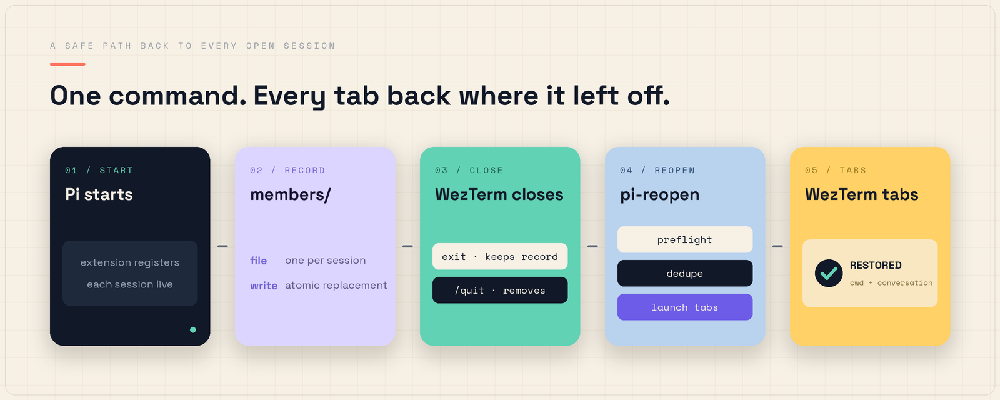

# pi-reopen — WezTerm を再開して Pi セッションを復元

[English](README.md) · [简体中文](README.zh-CN.md) · [日本語](README.ja-JP.md) · [한국어](README.ko-KR.md) · [Deutsch](README.de-DE.md) · [Français](README.fr-FR.md) · [Español](README.es-ES.md) · [Português (BR)](README.pt-BR.md) · [Русский](README.ru-RU.md) · [Pi パッケージ](https://pi.dev/packages/@ellieyujin/pi-reopen) · [リリース](https://github.com/AuthurX/pi-reopen/releases)

**閉じたターミナルの Pi coding agent セッション、作業ディレクトリ、対話を 1 コマンドで復元します。**


[Pi](https://github.com/earendil-works/pi) の拡張と CLI。**ターミナルを閉じた後のセッション復元**用。開いている Pi セッションを記録し、[WezTerm](https://wezterm.org/) のタブとして再開し、すでに実行中のセッションはスキップします。

## セッションを 1 つ再開するか、ワークスペースを復元するか

| ゴール | 使用 |
| --- | --- |
| カレントディレクトリの最新セッションを続ける | 組み込み `pi -c` |
| 過去の対話を選ぶ | 組み込み `pi -r` または `/resume` |
| WezTerm を閉じた後、プロジェクト横断の記録済み Pi セッションを再開 | `pi-reopen` |
| タブを開かず復元プランをプレビュー | `pi-reopen restore --dry-run` |

これはワークスペースの**セッション復元**であり、Pi のセッションピッカーの代替ではありません。元のセッションファイルで新しい Pi プロセスを起動するもので、実行中のツール、未保存の状態、スプリットペインのジオメトリ、任意のシェルプログラムは復元しません。Pi を意図的に終了すると登録が削除されます。WezTerm の起動時に自動復元は行われず、再開後に `pi-reopen` を実行してください。

## 使い方: ブラウザのタブと考えると理解しやすい

| ブラウザ | pi-reopen |
| --- | --- |
| 終了時に開いていたタブ | WezTerm を閉じたときまだ開いていた Pi セッション |
| 次回起動時に開いていたタブが戻る | `pi-reopen` が保持された記録を新しいタブとして復元 |
| 自分で閉じたタブは復元リストに入らない | `ctrl+w` で閉じたタブはデフォルトで忘れられる(Pi 内で `/quit` すると常に忘れられる) |
| Ctrl+Shift+T の「最近閉じたタブ」 | `/reopen recent` — 過去 24 時間、記録がなくても対象 |
| クラッシュ → 「ページを復元しますか?」 | クラッシュ / WezTerm 全体を閉じる / WSL シャットダウン → 全記録を保持、`pi-reopen` で復元 |

覚えておくべきルール: **開いておく = 保持、閉じる = 解放**。マーカーや余計なコマンドは不要です — タブを開いておくことが「これは戻してほしい」というシグナルで、閉じることは「もう終わり」という意味になります。(デフォルト: タブを閉じると復元リストから外れる、ブラウザ風の動作。`PI_REOPEN_FORGET_ON_TAB_CLOSE=0` を設定すると常に記録を保持。)

## 使用場面とプラットフォーム対応

**WezTerm で複数プロジェクトをまたいで作業する場合に設計されています: 複数の Pi セッションを開いており、ターミナルを閉じた後に、記録されたセッションの作業ディレクトリと対話を取り戻したい、という場面。** WezTerm を再開し、`pi-reopen` を実行すると、復元待ちのセッションを新しいタブとして復元します。

| 実行環境 | 対応状況 | セッションの復元先 |
| --- | --- | --- |
| ネイティブ Linux | 実装済み | ローカル Linux の WezTerm インスタンスの新しいタブ |
| ネイティブ macOS | 実装済み | ローカル Mac の WezTerm インスタンスの新しいタブ |
| ネイティブ Windows | 実装済み | ローカル Windows の WezTerm インスタンスの新しいタブ(ネイティブ Windows の Pi を実行) |
| WSL | 実装済み | Windows WezTerm の新しいタブ(対応する WSL ディストリビューションで Pi を起動) |
| FreeBSD とその他の OS | 非対応 | 復元プリフライトが非対応プラットフォームを拒否 |

**復元先はローカルの WezTerm のみです。** Windows Terminal、iTerm2、VS Code 統合ターミナル、tmux への復元はサポートされていません。PowerShell、Bash、zsh はシェルであり、復元先のターミナルアプリケーションではありません。PowerShell からコマンドを実行しても、WezTerm が開いている必要があります。ネイティブ Windows と WSL は別々の環境で、片側のインストールではもう片側のセッションは復元できません。マシンの横断する移行もサポートされていません。

「実装済み」はプラットフォーム固有の復元パスが存在することを意味し、すべての実機シナリオが検証済みであることを意味しません。検証カバレッジと制約は[プラットフォームノート](docs/PLATFORMS.md)を参照してください。

## クイックスタート

`@ellieyujin/pi-reopen` が唯一メンテナンスされる npm パッケージです。CLI コマンドは `pi-reopen` のままです。

```bash
pi install npm:@ellieyujin/pi-reopen@latest
npm install -g @ellieyujin/pi-reopen@latest --omit=peer
pi-reopen setup
```

`setup` は拡張ソース、記録中プロセスの生存確認、グローバル CLI と PATH、バージョン整合性、重複するレガシーエントリの確認を集約します。プラットフォーム固有の次コマンドを表示しますが、`sudo` や `setx` は実行せず、システム設定を変更しません。

既存の各 Pi で `/reload` を実行して記録を始めてください。WezTerm を閉じて再開した後は:

```bash
pi-reopen restore --dry-run
pi-reopen
```

パッケージ名を切り替える前に[インストールと移行](#インストール)をお読みください。

## 要件

- **Linux / macOS / ネイティブ Windows + ローカル WezTerm**、または **WSL + Windows WezTerm**
- Node ≥ 22.19、同じ OS 環境に [Pi](https://github.com/earendil-works/pi) インストール
- 復元前に WezTerm を起動; このツールは実行中のインスタンスにタブを追加するもので、リモート SSH ドメインではありません
- Linux/macOS/WSL は Bash が必要。ネイティブ Windows は Windows PowerShell 5.1(CIM 含む)が必要; Pi の Bash ツールには Git for Windows をインストールし、最近の WezTerm nightly を推奨
- WSL の復元はディストリビューションのデフォルトユーザーを使用; そのユーザーとしてこのツールを実行してください。ネイティブ Windows と WSL で 1 つのレジストリを共有しないでください

1.0.0 は最初の安定版です。CI は Linux、macOS、Windows でプラットフォームテストを実行し、Linux では完全な回帰スイート、パッケージ化 tarball チェック、実 Pi PTY ライフサイクルを実行します; macOS/Windows の GUI クローズ/再開の受入は実機検証が必要です。[プラットフォームノート](docs/PLATFORMS.md)を参照。

## 使い方

```bash
pi-reopen
```

```text
  ✔ pi-workspace: 起動して確認済み (/home/ellie/work/MY/code/pi-workspace)
  ⚠ other-proj: タブ作成済み、pi の起動確認が期限内に取れなかった (/home/ellie/work/other-proj)
2 件処理しました
```

出力はロケールに従います: `zh_*` は中国語、その他は英語。`PI_REOPEN_LANG=zh|en` で強制できます。

| 出力 | 意味 |
| --- | --- |
| `✔ 起動して確認済み` | 起動して確認済み |
| `⚠ タブ作成済み、pi の起動確認が期限内に取れなかった` | タブは作成されたが pi の起動確認がタイムアウト |
| `N 件処理しました` | N 件処理 |

Pi 内の等価なエントリポイント:

- `/reopen` — 登録済みの Pi を復元
- `/reopen recent` — 過去 24 時間の対話履歴から拾う(未登録ウィンドウ向け)
- `/reopen clear` — レジストリをクリア(対話ファイルは削除しない)
- `Ctrl+Shift+O` — ワンクリック復元

`/all` は `/reopen` の非推奨エイリアスとして引き続き動作します(リネーム通知を表示)。

## コマンド

| コマンド | 説明 |
| --- | --- |
| `pi-reopen`(= `pi-reopen restore`) | 最後に閉じた時点で開いていた Pi を再開; 実行中のはスキップ |
| `pi-reopen restore --dry-run` | プランのみ表示、タブは開かない |
| `pi-reopen restore --no-wait` | 各 pi の起動確認の待ちをスキップ |
| `pi-reopen restore --only <パターン>` | 一致するセッションのみ復元(部分文字列、`*` グロブ、または現在リストのインデックス; 名前、パス、id) |
| `pi-reopen restore --interactive` | 現在のリストを表示してインデックスでセッションを選択 |
| `pi-reopen restore --limit <N>` | 今回の実行で最大 N 個のタブを開く; 残りは次回に延期 |
| `pi-reopen restore --json` | 機械可読な出力 |
| `pi-reopen list [--wide\|--json]` | 登録メンバーと状態のリスト; 長い内容はデフォルトでターミナル幅に切り詰め |
| `pi-reopen show <インデックス\|id\|プレフィックス> ...` | 状態、パス、セッションファイル、登録詳細を表示 |
| `pi-reopen forget <インデックス\|id\|プレフィックス> ...` | 特定記録を削除(対話ファイルは無変更) |
| `pi-reopen prune [--dry-run]` | 期限切れ/復元不能な記録を削除(最近 14 日間は保持) |
| `pi-reopen setup` | 初回実行のガイド付きチェック; コマンドを表示するがシステムを変更しない |
| `pi-reopen doctor` | 環境とレジストリのチェック(拡張プロセス同一性、バージョン一致、WSL 単一タブクローズ検出) |
| `pi-reopen clear` | レジストリと起動クレームをクリア(対話ファイルやレガシー形式記録は削除しない) |
| `pi-reopen --help` / `--version` | 使い方 / バージョン |

`#` 列は**現在のリストスナップショット内のインデックスであり、安定 ID ではありません**。各コマンドは最新リストの同じ順序で解決します; 追加、削除、タイムスタンプの並び替え後は、もう一度 `pi-reopen list` を実行してください。純粋な数値入力はまずインデックスとして扱われます; セッション ID と一意プレフィックスも引き続きサポートされます。

```bash
pi-reopen list
pi-reopen restore --only 1,3 --dry-run
pi-reopen show 2
pi-reopen forget 2
pi-reopen restore --interactive
```

`list` の状態: 実行中 / 起動クレーム中 / 復元待ち / 期限切れ / 他のウィンドウで開いている / 作業ディレクトリ不在 / セッションファイル不在 / `--only` に一致しない / `--limit` で延期 / 他のプラットフォームまたはディストリビューション / 重複エントリ。

終了コード: 0 成功; 1 復元リクエスト失敗または未知のコマンド; 2 環境プリフライト失敗; 3 リクエストは送信されたが未確認; 4 スキップのみ(クレーム済み/延期)。

## インストール

### npm から

`@ellieyujin/pi-reopen` と安定版 `latest` dist-tag を使用してください。スコープなしの `pi-reopen` パッケージは公開取り消し済みです。スコープなしの `pi-workspace`(npm) は別の作者のプロジェクトです。

```bash
pi install npm:@ellieyujin/pi-reopen@latest
npm install -g @ellieyujin/pi-reopen@latest --omit=peer
pi-reopen setup
```

- `pi install` は拡張を登録してロードしますが、CLI が通常シェルの PATH にあることは保証されません; `npm install -g` が外部 CLI をインストールします(npm グローバル bin ディレクトリも PATH にある必要があります)
- CLI は Pi の peer パッケージに依存しないため、ホストもインストールしないよう `--omit=peer`; 2 つのインストールは個別に更新して同じバージョンを維持する必要があります(`pi-reopen setup` / `doctor` が乖離を報告)
- `pi install` は最小 peer バージョン(`>=1.5.0`)のみを宣言し、上限はありません: 更新の Pi なら直接インストール可能

**登録には拡張が必要です**: CLI のみのインストールではセッションを記録できません。インストール後、各開いている Pi で `/reload` または再起動を実行してください; 新規インストールでは以前未登録だったウィンドウを正確に復元できません。古いローカル拡張エントリ(例: 古い `open-all.ts` シンボリックリンクや別個の `pi-reopen` コピー)をパッケージと同時にロードしないでください。`pi-reopen setup` はパッケージソースと個人拡張ディレクトリの疑わしい重複エントリをチェックします; `pi list` で確認し、古いエントリのみを無効化し、セッションや認証ファイルを削除しないでください。`doctor`/`setup` は PID、プロセス開始時刻、boot ID で自己記録を検証します; 古い `extension.json` だけでは拡張が現在実行中とは限りません。

### 公開取り消し済みパッケージからの移行

`@ellieyujin/pi-reopen` のユーザーはパッケージ名を変更する必要はありません。現在公開取り消し済みの `pi-reopen` をインストールしていた場合は、メンテナンス中のパッケージをインストールする前に削除し、重複ロードと CLI の競合を避けてください。`pi list` を確認し、そこに表示される正確な古いソースを削除してください。`@latest` でインストールした場合:

```bash
pi remove npm:pi-reopen@latest
npm uninstall -g pi-reopen
pi install npm:@ellieyujin/pi-reopen@latest
npm install -g @ellieyujin/pi-reopen@latest --omit=peer
```

Pi を再起動し、`pi-reopen doctor` を実行してください。セッションファイルと `~/.pi/agent/pi-reopen/` の登録は無変更です; 削除しないでください。CLI と拡張のバージョンは一致させる必要があります。ローカル拡張リンク(例: 古い `open-all.ts` や `pi-reopen` シンボリックリンク)を npm パッケージと組み合わせて使用しないでください。

### ソースから

以下のコマンドは Linux/macOS/WSL で実行し、現在チェックアウト中のソースをインストールします:

```bash
git clone https://github.com/AuthurX/pi-reopen.git
cd pi-reopen
pi install .
mkdir -p "$HOME/.local/bin"
ln -s "$PWD/bin/pi-reopen.js" "$HOME/.local/bin/pi-reopen"
export PATH="$HOME/.local/bin:$PATH"
pi-reopen setup
```

将来使用するため、PATH 設定をシェルの起動ファイルに保存してください。CLI シンボリックリンクが既に存在する場合は、まずリンク先を確認し、無断で上書きしないでください。

ネイティブ Windows では、チェックアウトしたリポジトリから PowerShell で:

```powershell
pi install .
node .\bin\pi-reopen.js doctor
node .\bin\pi-reopen.js
```

PowerShell の実行ポリシーが npm の `.ps1` shim をブロックする場合は `pi` の代わりに `pi.cmd` を使用してください; ポリシーの変更は不要です。

拡張のみ必要なら、プッシュされた Git バージョンを直接インストールすることもできます:

```bash
pi install git:github.com/AuthurX/pi-reopen
```

## オプション設定

| 環境変数 | 目的 |
| --- | --- |
| `PI_REOPEN_WEZTERM` | ローカル WezTerm の絶対パス(`wezterm` / `wezterm.exe`); WSL では Windows パスを使用、例: `/mnt/c/Program Files/WezTerm/wezterm.exe` |
| `PI_REOPEN_PI_BIN` | Pi 実行ファイルの絶対パス、引数なし; Windows は npm の `pi.cmd`、パッケージの JS エントリ、または `.exe` を受け付けます; エイリアス/関数は非対応 |
| `PI_CODING_AGENT_DIR` | 別の Pi 設定/レジストリディレクトリを使用; CLI と拡張は一致させる必要があります |
| `PI_REOPEN_SRC` | 開発専用: 共有 `src/` ディレクトリをオーバーライド; 通常のパッケージインストールでは不要 |
| `PI_REOPEN_LANG` | 出力言語を強制: `zh` または `en`(デフォルトは `LC_ALL`/`LANG` から) |
| `PI_REOPEN_TERMINAL` | ターミナルアダプター id; `wezterm` のみ実装済み([docs/TERMINALS.md](docs/TERMINALS.md)参照) |
| `PI_REOPEN_MAX_AGE_DAYS` | 何日後に死んだ記録が復元されなくなるか(デフォルト 14、`0` で無効) |
| `PI_REOPEN_FORGET_ON_TAB_CLOSE` | 単一のタブを閉じる(WezTerm に他のタブあり)を「タスク完了」として記録を削除(デフォルト オン); ターミナル全体を閉じるか判定不能の場合は記録を保持。`0`/`false` で常に記録を保持 |

レガシー名(`PI_WORKSPACE_*`)も引き続き有効です; 両方が設定されている場合は正規の `PI_REOPEN_*` 名が優先されます。

例えば Pi を nvm、pnpm、カスタム npm prefix でインストールしている場合は、明示的に設定してください:

```bash
export PI_REOPEN_PI_BIN="$(type -P pi)"
export PI_REOPEN_WEZTERM="/mnt/c/Program Files/WezTerm/wezterm.exe"
pi-reopen doctor
```

Linux/macOS/WSL では Pi は PATH と Bash ログイン環境から特定されます。ネイティブ Windows は PATH から `pi.exe` または npm の `pi.cmd` を解決します; npm shim は Node + インストール済みパッケージエントリに解決され、`cmd.exe` の引用符と PowerShell スクリプトポリシーの問題を回避します。非標準の Windows shim には明示的な JS エントリまたは `.exe` が必要です。復元されたタブは呼び出し側の PATH とエージェントディレクトリを受け取り、完全な環境や認証データではありません。WezTerm 探索はプラットフォーム固有の PATH と一般的なインストール場所を確認します; `where.exe` + `wslpath` を使うのは WSL のみです。カスタムレイアウトには明示的なパスを設定してください。環境変数を変更した後は Pi を再起動してください; `/reload` は親シェルの新しい環境を読み込みません。

## 仕組み



- **登録**: Pi の各起動時に、`{セッションファイル絶対パス, cwd, pid, processStart, bootId, paneId, weztermPid (WSL), platform, distro, user, schemaVersion}` がリアルタイムで `~/.pi/agent/pi-reopen/members/` に書き込まれます(セッションごとに 1 ファイル、アトミック置換)。0.3.0 以前が `pi-workspace/` 配下に書いた記録も引き続き読み取りとクリーンアップの対象です。
- **クローズ検出**: Pi のシグナル終了も `quit` クリーンアップイベントを発行するため、イベント名だけでは信頼できません。拡張は TUI ライフサイクル内で SIGHUP/SIGTERM を記録します; シグナルなしの意図的な `/quit` やセッション切り替えは記録を削除し; リロードは記録を保持してリスナーをクリーンアップします。追跡されたシグナルがない場合、WezTerm に現在のパネ(`WEZTERM_PANE`)がまだ存在するかを問い合わせます: パネが消失している場合はウィンドウが閉じたことを意味し、記録は保持されます。デフォルトでは(`PI_REOPEN_FORGET_ON_TAB_CLOSE=0` でオプトアウト)、WezTerm に他のパネがある場合、消失したパネは削除されます(1 つのタブを閉じる = タスク完了、ブラウザ風の「閉じたタブは復元セットに入らない」); 他のパネがないか判定不能の場合は記録を保持します。WSL では、`list`/`restore` が健全な CLI プロセスから再調整します: 削除には、一致するシグナルクローズマーカー、同じ登録済み GUI PID、Pi の死亡、元パネの不在、少なくとも 1 つの残りパネが必要です。クローズマーカーなしのクラッシュ、再起動された WezTerm、クエリ失敗は復元のために記録を保持します。強制 kill でクリーンアップが妨げられた場合、残骸は記録されます。停電時には、永続化された記録が復元される最大限であり、最新のリフレッシュされていない変更は保証されません。
- **安全な起動**: タブは並行して開かれます(デフォルト同時 5 個); 各 `wezterm cli spawn` リクエストは 15 秒応答なしでエラーで中断され、3 連続のリクエスト失敗で早期停止し、WezTerm が詰んでいる場合の長時間待機を避けます。`--limit` がバーストを制限します。
- **重複排除**: 復元前にプロセスの生存が確認されます(pid + 開始時刻 + bootId; リブート後の古い PID は誤判定されません)、実行中プロセスは `--session <ファイル>` をスキャンされ未登録ウィンドウが 2 回開かれることを防ぎ、起動クレーム(60 秒 TTL + 保有者生存チェック)が重複リクエストを減らします。グローバル復元ロック(`restore.lock`、30 分 TTL + pid 生存 + bootId チェック)は `O_EXCL` で作成されるため、並行復元が同時にバッチを開始できません; ロック保有者が死亡したり OS がリブートしたりしたら引き継ぐことができます。
- **検証**: 「リクエスト受領」と「pi 登録済み」は別々に報告されます; 確認ウィンドウはバッチサイズに応じて拡大します(15s + セッションあたり 2s、上限 90s)。
- **タイトルと衛生管理**: タブはセッション名、それがなければ cwd フォルダ名でタイトル付けされます。14 日以上の記録は `expired` になり自動復元されなくなります; `forget`/`prune` は対話ファイルを触らずにクリーンアップします。
- **安全性**: プリフライト(プロセス同一性 / 実行中 WezTerm / Pi / ターミナルアダプター / レジストリ健全性、該当する場合は WSL 相互操作を含む)が失敗すると、何も一括で起動されません; 自動 sudo は決して行いません; ENOEXEC には修正ヒントが付きます。

## 開発とテスト

```bash
# リポジトリルートから
npm test                    # Linux/WSL 完全回帰スイート(統合テストはスキップ)
npm run test:platform       # ネイティブ Linux/macOS/Windows スイート
npm run verify-pack         # tarball を構築、内容を確認、展開した CLI を実行
npm run test:integration    # 実 WezTerm spawn/タイトルテスト(実行中 WezTerm が必要)
python3 test/pty-shutdown.py # 実 Pi PTY: シグナルで記録保持、/quit で削除
```

```text
extensions/index.ts      Pi 拡張(薄いアダプター層): 生存中の Pi を登録、/reopen を提供
src/                     共有コア(純 JS ESM、拡張と CLI の両方で使用)
  terminals/             ターミナルアダプター(wezterm; docs/TERMINALS.md 参照)
  platform/windows/paths/liveness/members/claims/plan/preflight/discover/
  launch/spawn/verify/restore/cli/prune/health/inuse/pane/sessions/i18n/version
bin/pi-reopen.js         CLI エントリポイント(node で直接実行、ビルドステップなし)
test/                    Node 組み込みテスト(隔離ディレクトリ + 注入モック、実ターミナル呼び出しなし)
docs/                    要件、状態、プラットフォーム、ターミナル、公開
```

テストはコア復元、シグナル処理順序、リロードクリーンアップ、パネベースのクローズ検出、`/reopen recent` 選択、非標準 Pi インストールパス、シェルエスケープ、レガシーディレクトリからの記録マージ、スキーマゲーティング、i18n、パッケージ移動後の読み込みをカバーします; テストは一時ディレクトリとモックランチャーで隔離されています。テストフック `PI_REOPEN_HOOKS` は通常使用时に設定しないでください。

CI は Linux/macOS/Windows でプラットフォームスイート、Linux で完全スイート、パッケージ化 tarball チェック、実 Pi PTY ライフサイクル(Pi ホストをインストールします)を実行します。CI は WezTerm GUI を開けないため、実 spawn/タイトルテストは `PI_REOPEN_INTEGRATION=1` でのオプトインのままです。

メンテナーのリリース手順: [公開ガイド](docs/PUBLISHING.md)と[CHANGELOG](CHANGELOG.md)を参照。

## フィードバックと共有

これがターミナル再起動ワークフローを解決するなら、他の Pi / WezTerm ユーザーに[リポジトリ](https://github.com/AuthurX/pi-reopen)を共有してください。[復元問題を報告](https://github.com/AuthurX/pi-reopen/issues)する際は、OS、Pi/WezTerm バージョン、**マスク済み**の `pi-reopen doctor` 出力を添付してください。認証情報やプライベートな対話ファイルをアップロードしないでください。[アウトリーチドラフトと計測プラン](https://github.com/AuthurX/pi-reopen/blob/main/docs/promotion/README.md)を参照。

## 貢献者

- [AuthurX](https://github.com/AuthurX)
- [abelxiaoxing](https://github.com/abelxiaoxing)

## ライセンス

[MIT](LICENSE), Copyright (c) 2026 ellieyujin
